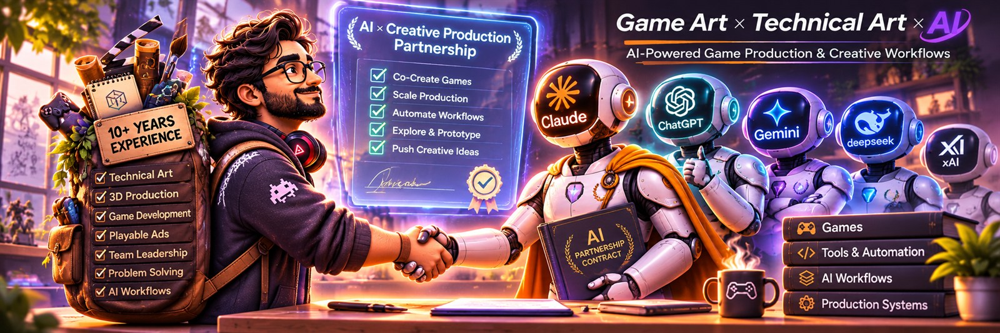

# Bilawal Baig

**AI + Game Pipeline Lead** · Technical Art, Animation & Game Development · three.js Playable Ads

 

## About

I use AI and code to rethink how game art is created, production tools are built, and playable ads are developed.

My background is in 3D art and technical game production. My work has moved from creating game assets to building smarter ways to create them. Today I focus on AI-driven game art production, building custom tools with AI, and coding playable ads.

My approach is hands-on: experiment, build, test, and improve.

## What I work on

- **AI-driven game art production:** bringing AI tools into existing production so there is less repetitive work.
- **Custom tools and AI agents:** tools, skills and agents that solve practical production problems.
- **Playable ads:** a plugin that converts Unity game projects into web-based playable experiences, tested on real projects and still being refined.
- **Creative production for mobile games:** planning video ads, playable ads and creative variations, and removing bottlenecks in the pipeline.

## Tech stack

- **Engines and DCC:**     
- **Code:**   
- **Graphics and web:** Shaders ·  
- **AI tools and automation:**     

## AI production experiments

Small experiments in AI-driven game art production. I guide the direction and review the results; AI carries out much of the art work.

- **[Kittydoku](https://play.google.com/store/apps/details?id=com.mindstorm.kittydoku):** the first experiment. AI handled the workflow from tile concepts and artwork to 3D modeling, animation, VFX and Unity integration.
- **[Toyland Go!](https://play.google.com/store/apps/details?id=com.mindstorm.goodsortshooter)** and **[Mall Bus Jam](https://play.google.com/store/apps/details?id=com.mindstorm.molebusjam):** the same approach on two more games. The artwork for both was done in one day, with a lot of human direction and review.

## Games and projects I've worked on

These are the titles listed under my roles on LinkedIn, grouped by company. Some older store pages are no longer online, so a few titles have no link.

**Mindstorm Studios**
- Mobile games: [Hexa Sort](https://play.google.com/store/apps/details?id=com.gamebrain.hexasort), [Bloom Sort](https://play.google.com/store/apps/details?id=com.bloom.sort) ([work on Behance](https://www.behance.net/gallery/206288621/Bloom-Sort-World)), [Match Ball 3D](https://play.google.com/store/apps/details?id=com.match.match3d), [ParkoV](https://play.google.com/store/apps/details?id=com.thunderzone.parkov), [Tile Garden](https://play.google.com/store/apps/details?id=com.tilegarden.match3), [Bubble Garden](https://play.google.com/store/apps/details?id=com.bubble.garden)
- Also listed, store pages no longer online: Find Ball 3D, Find It 3D, Happy Grave, Foot Spa
- Playable ads: [Unity Gameplay Ads](https://www.behance.net/gallery/155307473/Unity-Gameplay-ADs)

**Mars 1982 Ltd**
- [Sanrio Blast](https://www.behance.net/gallery/106410371/Sanrio-Blast), [GlobeMatcher](https://www.behance.net/gallery/106389771/GlobeMatcher) and [Robot Train AR](https://www.behance.net/gallery/77810529/Robot-Train-AR) on Behance. Tap&Win is also listed, but its store page is no longer online.

**Rematch Studios**
- [Area of Darkness: Sentinel](https://store.steampowered.com/app/626810/Area_of_Darkness_Sentinel/), a cinematic VR adventure on Steam
- [Whackimals AR](https://www.behance.net/gallery/77819629/Whackimals-AR) on Behance

**Dead Pixel Labs**
- [Them or Us](https://store.steampowered.com/app/1964020/) on Steam, plus my animation work: [FPS animations](https://www.behance.net/gallery/206443485/DeadPixel-FPS-Animations) and [Unreal animation](https://www.behance.net/gallery/157388221/DeadPixel-Labs-Unreal-Animation)

**Mictlan: An Ancient Mythical Tale**
- [Steam page](https://store.steampowered.com/app/1411900/) and my [cinematic and animation work](https://www.behance.net/gallery/206426689/Mictlan-Cinematic-and-Animation) on Behance

## Experience

- **2020 – now:** Lead 3D Artist — Creative Production, Playable Ads & AI-Assisted Pipelines · Mindstorm Studios (Sr. 3D Artist before that)
- **2020 – 2026:** Technical Animator (part-time) · Dead Pixel Labs, LLC
- **2020 – 2022:** Character Technical and Mocap Consultant (part-time) · Mictlan: An Ancient Mythical Tale
- **2019 – 2020:** Game Project and Production Manager (remote) · Mars 1982 Ltd
- **2016 – 2019:** Technical Game Artist and Animator · Rematch Studios
- **2013 – 2016:** Senior Creative Producer · Back Check Group, and Assistant Creative Manager · Red Tape Media

## Education

- BS, Computer Science · University of the People (in progress, 2023 – 2028)
- Master's in Media Sciences, Design & Advertising · Iqra University (2014 – 2018)

## Open-source projects

- **[CocosCreator-Batch-Builder](https://github.com/bilawalbaig8/CocosCreator-Batch-Builder):** starter kit for mass-building Cocos Creator 3.8.7 playable ads. Automated multi-scene builds, iteration variants, superHTML packaging, Playwright scene validation and a local web dashboard.
- **[hire-an-engineer](https://github.com/bilawalbaig8/hire-an-engineer):** a skill that turns an AI coding tool into a planning-and-building engineer for people who build with AI but have no engineering background. Works with Claude Code, Cursor, Codex and other agents. MIT licensed.
- **[delegate-to-gemini](https://github.com/bilawalbaig8/delegate-to-gemini):** a Claude Code skill that sends research, drafting and analysis tasks to Gemini and keeps shared project memory between both tools.

## GitHub stats

