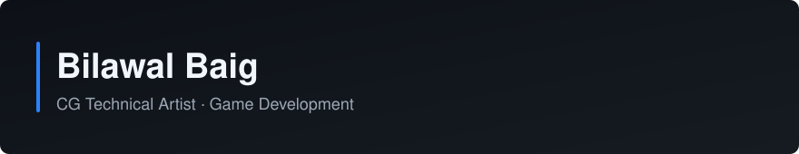

  

## About

CG Technical Artist / 3D Technical Artist working in game development.
I work on technical art, shaders, playable ads and AI-assisted creative production pipelines.

## Tech stack

| | |
|---|---|
| **Engines and DCC** |     |
| **Code** |    |
| **Graphics and web** | Shaders ·   |
| **Workflow** | AI-assisted art and game production |

## Featured projects (original work)

- **[CocosCreator-Batch-Builder](https://github.com/bilawalbaig8/CocosCreator-Batch-Builder)**: starter kit for mass-building Cocos Creator 3.8.7 playable ads. Automated multi-scene builds, iteration variants, superHTML packaging, Playwright scene validation and a local web dashboard.
- **[hire-an-engineer](https://github.com/bilawalbaig8/hire-an-engineer)**: a skill that turns an AI coding tool into a planning-and-building engineer for people who build with AI but have no engineering background. Works with Claude Code, Cursor, Codex and other agents. MIT licensed.
- **[delegate-to-gemini](https://github.com/bilawalbaig8/delegate-to-gemini)**: a Claude Code skill that sends research, drafting and analysis tasks to Gemini and keeps shared project memory between both tools.

## Other repositories

| Repository | What it is |
|---|---|
| [MassiveRaid](https://github.com/bilawalbaig8/MassiveRaid) | Unity project (C#) |
| [Assignment3FunctionsGUI](https://github.com/bilawalbaig8/Assignment3FunctionsGUI) | C# functions with a GUI (assignment) |
| [BookLibrary_A02](https://github.com/bilawalbaig8/BookLibrary_A02) | Java, UoPeople assignment |
| [Python-Practice](https://github.com/bilawalbaig8/Python-Practice) | Python practice exercises |

Forks, not my original work: [UnrealEditorPythonScripts](https://github.com/bilawalbaig8/UnrealEditorPythonScripts) (from mamoniem) and [MictlanMap](https://github.com/bilawalbaig8/MictlanMap) (from mictlanthegame).

## GitHub stats

